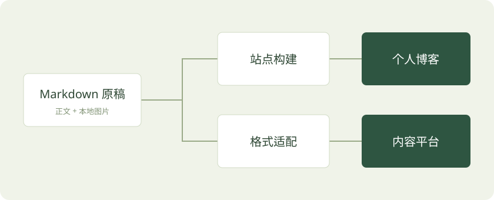

技术文章里的截图和示意图往往承担了关键解释工作。管理好图片，可以减少“正文还在，图片却找不到”的情况。

## 原图与正文放在一起

文章引用同目录的图片：

```markdown

```


这张图是本地 SVG 示例，随文章一起构建和发布，不依赖第三方图床。

## 把图片当作文章的一部分

- 文件名使用简单且有意义的名称。
- 路径大小写保持一致。
- 截图只保留解释问题需要的区域。
- 架构图同时保留可编辑源文件。

### 清晰度优先于盲目压缩

代码截图、数据表和架构图需要检查文字是否可读。照片可以适度压缩，技术图则应先保证信息完整。

## 网站发布与平台分发是两条流程

个人博客可以把图片和页面一起托管。分发到内容平台时，本地相对路径没有意义，需要把图片上传到平台，再替换正文链接。

| 阶段 | 图片位置 | 验证重点 |
| --- | --- | --- |
| 本地写作 | 文章目录 | 文件是否存在 |
| 博客上线 | 网站静态资源 | 链接、清晰度与加载 |
| 平台分发 | 平台图片存储 | 图片是否转存成功 |

## 发布前做一次完整阅读

用手机打开文章，检查图片有没有溢出，代码能否横向滚动，目录和上下篇是否可用。一次从头到尾的阅读，往往能发现只看首页发现不了的问题。

**可执行的小练习：** 选择一篇有三张图片的文章，完成本地预览、生产预览和图片导出。
