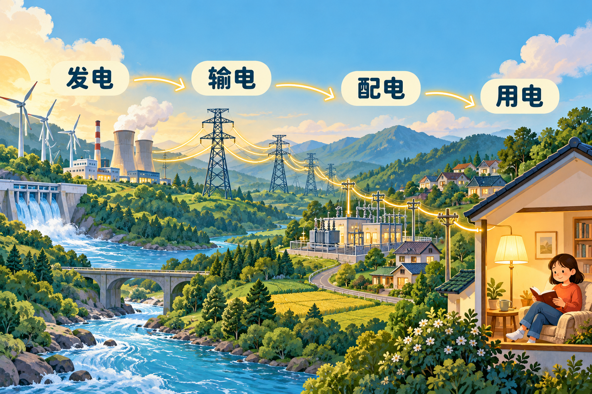
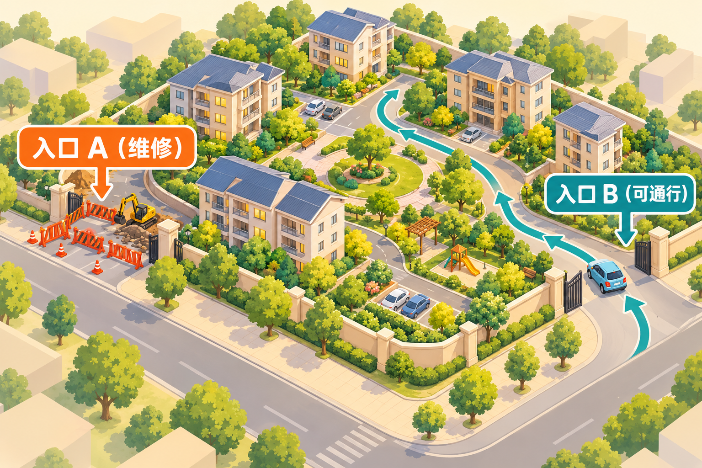
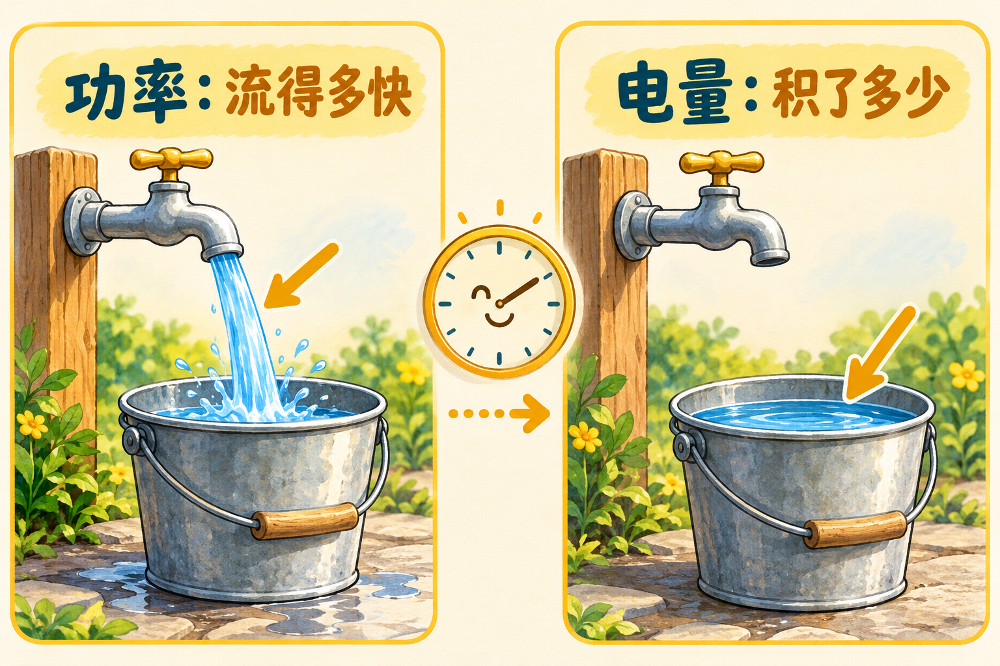

晚上回到家，按一下开关，灯就亮了。我们平时很少想：这份电从哪里来？走了多远？为什么随时打开开关，通常就有电可用？

理解电网，可以从这些小问题开始。你不需要先背公式，也不用一下子记住所有设备名称。下面我们借助送水、道路和水桶几个熟悉的例子，沿着“电来到家里”的过程慢慢看。

## 1. 电是怎样来到家里的？

### 1.1 先把电网想成一套送水系统

想象一座城市的供水：水从水厂出来，经过粗大的主管道，分到各个街区，再沿着小管道送进家里。

电从发电厂到用户，也有类似的层次：



*图 1：从远方的发电厂，到家里亮起的一盏灯。图中展示的是典型供电路径。*

| 电力环节 | 借助送水来理解 | 实际在做什么 |
| --- | --- | --- |
| 发电 | 水厂提供水 | 把风、水流、燃料等带来的能量变成电能 |
| 输电 | 城市之间的大管道 | 把大量电能送到较远的地方 |
| 配电 | 街区和楼里的分支管道 | 把电分配给小区、商铺、工厂等用户 |
| 用电 | 打开水龙头使用水 | 让灯发光、空调制冷、电机转动 |

这样就容易区分了：**输电侧重“远距离送过来”，配电侧重“分到各家各户”。**

不过，电和水并不完全一样。电网不是装满电的大水箱，不能把大量用不完的电随手留在线路里。这个区别，后面讲“实时平衡”时会用到。

### 1.2 为什么远距离送电前，要先提高电压？

说到电，最容易混在一起的是“电压”和“电流”。在水管的类比里，可以暂时把电压想成水压，把电流想成水流量。它们是不同的量，不要把“电压高”直接理解成“用电多”。

远距离送电时，有一个实用的规律：**送同样多的功率，在其他条件相同时，提高电压，就可以减小电流。**

为什么要减小电流？因为线路有电阻，电流流过会使线路发热。这部分热量就是送电过程中的损耗。电流越大，发热损耗越明显；在线路电阻不变时，电流降到一半，这部分损耗就会降到原来的四分之一。

所以，常见的送电过程是：

```text
发电厂发电
    ↓ 先升高电压，减少远距离输送中的损耗
高压线路把电送到城市附近
    ↓ 再逐级降低电压
配电线路把电送到小区
    ↓ 调整到用户设备需要的电压
家里的灯、冰箱、空调开始工作
```

你可能见过 500 kV、220 kV、10 kV、220 V 这些数字。现在不用背，先知道它们表示不同的电压等级就够了：远距离输送和家用电器，需要的电压条件不同。

这是一条典型路径，并非所有电都要走完它。例如，屋顶光伏就可能在用户附近发电，大型工厂也可能接入更高电压等级。

### 1.3 变压器、变电站和母线，分别是什么？

把供电过程想成一套分配系统，就比较容易理解这些名字。

**变压器**负责改变交流电的电压。可以把它理解成一个“档位转换装置”：需要远送时升压，接近用户时降压。它改变供电条件，本身不凭空制造电能。

**变电站**像一个分配枢纽。里面有变压器，也有连接线路、控制开关和保护设备，所以变电站是一整套设施，变压器只是其中一种设备。

**母线**听起来陌生，其实可以先理解成“公共连接排”：多条线路和设备在这里连接、汇集，再向不同方向分配电能。

至于**开关和保护装置**，可以借助家里的保护开关理解：发现某些故障时，需要及时断开相关电路，尽量避免问题扩大。电网里的保护体系比家用设备复杂得多，但“发现问题、隔离问题”的思路相通。

## 2. 交流电和直流电，到底差在哪里？

### 2.1 先看充电宝和墙上的插座

给手机充电，你可能用过两种方式：接充电宝，或者把充电器插到墙上。

充电宝的电池侧是直流，家里墙上插座提供的是交流。手机电池需要直流充电，所以从插座充电时，充电器会完成转换，并调整到设备需要的电压。

“直”和“交”主要说的是电压、电流的变化方式：

- **直流电 DC**：可以先想象成沿一个方向流动的水，电流方向不会像交流那样周期性交替。
- **交流电 AC**：可以想象一段水在管道里有节奏地往返运动，电压、电流随时间周期变化。

这个比喻只帮助理解方向的变化。交流电虽然来回变化，也能持续把能量传给电器，就像你来回拉动锯子，两个方向的动作都可以参与完成工作。

### 2.2 为什么两种电都在用？

因为它们适合的设备和场景不同。

电池和光伏组件的电气接口是直流；交流则可以方便地用变压器升压、降压，发电、输电和用电设备也形成了成熟的配套体系。

交流和直流之间还可以转换。把交流变为直流叫**整流**，把直流变为交流叫**逆变**。可以把相应设备理解成“接口转换器”，但转换设备有成本，也会有能量损耗。

这里特别容易产生一个误解：“直流只能给小电器用，不能远距离送电。”实际上，高压直流输电也承担着远距离、大容量送电的任务。选择交流还是直流，要看距离、容量、设备和成本，不能只凭名字判断谁更先进。

## 3. 电网里的线路，是怎么连接的？

如果把线路想成道路，就会发现：有的地方只有一条路可走，有的地方有备用入口，有的地方则四通八达。电网也有类似的连接方式。

### 3.1 放射式：像一条主路分出几条小路

```text
电源
  │
主线路
  ├── 分支 A ── 用户 A
  └── 分支 B ── 用户 B
```

想象一个村庄只有一条进村主路，进村后再分成几条小路。这样的结构简单，建设和管理都比较方便。

但如果主路中断，几条小路都会受影响；如果只是其中一条小路出了问题，其他分支还有可能正常通行。

对应到电网，故障发生在哪里、能否把故障部分单独断开，会影响停电范围。这种像树枝一样分开的结构，就叫**放射式**。

### 3.2 环网：像小区有两个入口

小区如果只有一个入口，门口修路就很麻烦；如果还有另一个入口，就多了一种绕行选择。



*图 2：一个入口修路，另一个入口可以帮忙。备用供电路径也有类似作用，但能否转供还要看容量和安全条件。*

配电环网可以借这个例子理解。常见运行方式是两边各自供电，中间留一个平时断开的联络开关：

```text
电源 A ── 用户区 A
              │
         联络开关（平时断开）
              │
电源 B ── 用户区 B
```

假如 A 侧出现问题，在隔离故障并确认条件允许后，可以利用联络路径，让 B 侧帮忙供电。

为什么要“确认条件”？因为备用入口也有通行能力。就像小门不能一下子容纳整个小区的车流，备用线路也未必带得动全部用户。

所以，**有备用路径意味着多一种恢复供电的机会，并不保证所有故障都能做到不停电。**

### 3.3 网状结构：像四通八达的城市路网

城市里从一个地方到另一个地方，往往有好几条路。输电网中也常有多条线路互相连接，一条线路停用后，其他路径可能分担输送任务。

但绕行会增加其他道路的压力。电网也一样：一条线路退出后，需要检查其他线路会不会承担过多功率。

这里有个与开车不同的地方：**电不会拿着合同挑一条指定路线走。**在相互连接的网络中，电能如何分配到不同路径，由线路连接和电气特性共同决定。

工程人员把这种功率分布叫作“潮流”。你暂时不需要会算，只要知道：买卖双方谈成交易后，还要确认电网承受得住。

## 4. 电很好用，为什么却不好“囤货”？

### 4.1 同样是电，可以让灯亮，也可以让水热

电的便利之处，是容易转换成我们需要的其他能量。

电灯把电能转成光和热；电热水壶用它加热水；电风扇的电机用它带动扇叶。发电则是另一头的转换，例如水轮机利用水流带动发电机，把水的能量转成电能。

所以，发电不是凭空“造出能量”，用电也不是让能量消失，而是在不同形式之间转换。

### 4.2 充电宝能存电，电网为什么还要随发随用？

想想你的充电宝：它能存下的电有限，充电要时间，给设备供电的功率也有限，还会在充放电时产生损耗。

大型储能也要面对类似问题，只是规模更大。电池把能量转成化学能储存；抽水蓄能则在电力充裕时把水抽到高处，需要时再放水发电。

因此，“电可以储存”和“电不能随便大量囤在线路里”并不矛盾。储能需要专门设备，而且要考虑容量、功率和成本。它能帮助调节供需，却不是无限大的仓库。

## 5. 功率和电量：一个看多快，一个看多少

### 5.1 用水龙头和水桶，一次分清两个概念

打开水龙头接水时，你会关心两个问题：

- 水流得有多快？比如每分钟流出多少水。
- 一共接了多少水？比如水桶里已经有多少升。

用电也一样：**功率描述用电或发电有多快，电量描述一段时间累计用了或发了多少。**



*图 3：看水流的快慢，对应功率；看桶里积了多少水，对应电量。*

| 电力概念 | 水的类比 | 常见单位 |
| --- | --- | --- |
| 功率 | 水龙头出水的快慢 | W、kW、MW |
| 电量 | 水桶累计接到的水量 | Wh、kWh、MWh |

家里常说的“用了 10 度电”，就是用了 10 kWh 电量。设备上标着“2 kW”，说的是功率，不能直接读成“用了 2 度电”。

### 5.2 一台 2 kW 的电暖器，开多久用几度电？

假设它一直以 2 kW 的功率工作：

```text
开 1 小时：2 kW × 1 h = 2 kWh，也就是 2 度电
开 3 小时：2 kW × 3 h = 6 kWh，也就是 6 度电
```

记住这一条就够用：

**电量 = 平均功率 × 时间。**

这里为什么加“平均”两个字？因为设备不一定一直按标注功率工作。比如电暖器达到设定温度后，可能暂停加热，再冷下来时重新启动。

假设一小时内，它以 2 kW 加热了半小时，另外半小时没有加热，忽略待机耗电，那么这一小时用了 1 度电，而不是 2 度。

风机也是一样：一台标称 1 MW 的风机，只有持续以 1 MW 发电一小时，才会发出 1 MWh。风小了，实际功率可能下降，发电量也会跟着减少。

### 5.3 kW、MW、kWh、MWh，怎样不看花眼？

像长度有米和千米一样，功率、电量也有大小不同的单位。

| 功率换算 | 电量换算 |
| --- | --- |
| 1 kW = 1,000 W | 1 kWh = 1,000 Wh = 1 度电 |
| 1 MW = 1,000 kW | 1 MWh = 1,000 kWh = 1,000 度电 |
| 1 GW = 1,000 MW | 1 GWh = 1,000 MWh |

最简单的辨别办法是看有没有 `h`。这里的 `h` 代表小时，`kWh` 是千瓦乘以小时，表示累计电量。

比如报价 500 元/MWh，意思是每 1,000 度电 500 元，也就是每度电 0.50 元。它与 0.50 元/kWh 是同一个单价，只是单位不同。

如果按这个假设单价用了 6 度电，电能费用就是 `6 × 0.50 = 3 元`。完整电费账单可能还有其他项目，后续[电价的组成](../electricity-price-components/)会继续介绍。

### 5.4 储能的功率和容量，像水龙头大小与水桶大小

看到一套储能写着 `1 MW / 2 MWh`，可以这样理解：

- **1 MW** 像水龙头的出水能力，说明它能以多大的功率充电或放电。
- **2 MWh** 像水桶的容量，说明它名义上能存多少能量。

只按这两个数字计算，以 1 MW 放电，2 MWh 可以维持 2 小时。实际还要考虑剩余电量、损耗和设备限制。

这也解释了两个常见问题：水桶很大，但水龙头很小，不能一下子大量供水；水龙头很大，但水桶很小，也供不了多久。挑选储能时，功率和容量必须一起看。

### 5.5 “无功”听起来没用，为什么还需要它？

先想一个你熟悉的动作：压缩弹簧，再让它回弹。压下去时，能量暂时存进弹簧；回弹时，能量又释放出来。

交流电路中的一些设备，也有类似的能量往返交换。例如，电机需要磁场来工作，一部分能量会暂时存进磁场，再返回电路。**无功功率**就是描述这类交流能量交换的一个量。

与之相对，**有功功率**描述的是实际转换为机械能、热能等的平均能量传递，例如让电机带动水泵抽水。

弹簧只是帮助理解“暂存、返回”这个过程，无功并不是一根真实的弹簧。你先记住：**无功不等于没用，也不等于全部变成了损耗。**但往返交换同样需要电流，会占用线路和设备的承载能力，也可能增加发热损耗。

设备还会标一个“视在功率”，单位常见 kVA、MVA，可以先把它理解成交流设备容量分析使用的量。它与有功功率的比值有关：

```text
功率因数 = 有功功率 ÷ 视在功率
```

比如有功功率为 80 kW、视在功率为 100 kVA，功率因数就是 0.8。这不代表“有 20% 的电被浪费了”，因为功率因数与能量转换效率是两个不同的概念。

刚入门时，分清它们各自在说什么，比背公式更重要。

## 6. 大家同时打开空调，电网怎么接得住？

### 6.1 像一条需要保持速度稳定的传送带

想象一条正在运行的传送带：电机负责带动它，带上的货物形成负担。如果突然加了很多货，而电机没有及时增加驱动力，传送带就可能慢下来。

电力系统也需要不断匹配供给和需求。用电设备增加，在电力行业里常说“负荷增加”；发电机增加发电功率，则常说“增加出力”。

当整个系统用电增加而供给来不及跟上时，系统频率通常会有下降趋势；反过来，供给多于消耗时，频率通常会有上升趋势。你可以把频率暂时理解成交流系统的“节拍”。传送带只是帮助理解供需失衡会影响运行状态，电网并不真是一条传送带。

所以，电网需要持续协调，尽量让这个“节拍”保持稳定。与此同时，还要管理电压，不能只顾总共发了多少电。

### 6.2 调度就像协调大家一起干活的人

夏天傍晚，很多人回家打开空调，调度需要根据实际情况协调资源，比如让能增加发电的机组增加出力、让储能放电，或让具备条件的用户暂时减少一部分用电。

如果某个时段光伏发电增加，也可能需要其他电源减少出力，或让储能充电。

这里可以用一个简单关系理解目标：

```text
发出来的功率 + 储能放出来的功率
    ≈ 用户正在用的功率 + 储能充进去的功率 + 输送损耗
```

它看的是整个系统的协调，不是要求某座电厂专门盯着你家的开关。你打开空调时，也不需要先给电厂打电话；背后已经有预测、自动控制和调度等机制持续配合。

这就是为什么电力交易谈成之后，还需要安排实际运行。合同解决“谁买谁卖”，调度还得解决“这一刻怎样安全地供上电”。

## 7. 都是一度电，为什么价值还会不同？

### 7.1 时间不同：像同一段路，高峰时更紧张

同一条道路，凌晨可能很空，早高峰却很拥挤。电力供应也有类似的忙闲变化：不同时段，用电需求和可用电源都可能不同。

例如，在一个光伏发电较多的地区，晴天中午太阳能提供不少电；到了傍晚，光伏出力下降，家里的空调和厨房电器却可能同时用起来，这时就需要其他资源接上。

因此，同样一度电，在供应宽裕和供应紧张的时候，价值可能不同。但不能死记“白天贵、晚上便宜”：新能源出力和用电情况会改变时段之间的供需关系。

这里说的是电力供需与市场价格的关系，并不意味着你家的电费单价一定每时每刻跟着变化；用户如何计费，还取决于适用的电价和合同。

### 7.2 地点不同：像产地水果便宜，送到城里还要过桥

假设一个地方水果很多，卖得便宜，但通往城市的桥每天只能让有限的货车通过。即使产地还有大量水果，也不能立刻全部送到城里。

电也有类似情况：某个地区电源充裕，但向外送电的线路有容量限制。另一个地区即使用电紧张，也无法无限量地从这里调电，可能仍需要使用当地成本较高的电源。

电力里说的“阻塞”，可以借这座桥理解：并不是完全没有路，而是这条路径能承担的输送量有限。电网还需要考虑设备安全和其他运行条件，比单看一座桥更复杂。

### 7.3 所以，买电还要问什么时候、在哪里

买一箱水果，数量和价格之外，你也会关心什么时候送到、送到哪里。买电同样需要问清这些问题，而且时间、地点与电网能否完成交付紧密相关。

所以看到一份电力报价，不能只盯着“每度多少钱”，还要看对应的电量、时段、交付位置与结算方式。

至于双方怎样谈价、挂牌或集中竞价，可以接着看[电力市场化](../electricity-marketization/)。这一章先把交易背后的供电过程理解清楚。

## 8. 用三个生活问题，看看自己有没有读懂

### 8.1 2 kW 的电暖器，开一小时一定用两度电吗？

如果它一直以 2 kW 工作，就用两度电；如果中间停止加热或降低功率，就要按实际情况计算。就像水龙头开了一小时，但中间关过几次，接到的水不会和全程开着一样多。

### 8.2 小区有两条供电路径，就一定不会停电吗？

不一定。就像有两个入口的小区，也可能遇到两边都受影响，或备用入口承受不了全部车流。备用供电路径提高了恢复供电的机会，但仍要检查故障和设备条件。

### 8.3 远处的电很便宜，就一定能无限买过来吗？

不能。就像产地有便宜水果，还要看运输通道是否够用。电网有输送能力和安全条件的限制，价格便宜并不代表随时随地都能送到。

回想最开始那盏灯：一次简单的按开关，背后连接着发电、输电、配电，以及持续进行的供需协调。理解了这条线，再去看电力市场里的价格、合同和交易规则，就有了具体的参照。

> 整理来源：个人笔记《电网基础知识》。文中的送水、道路、水桶等类比用于帮助入门，分别解释不同概念，不代表电网与这些系统完全相同。
