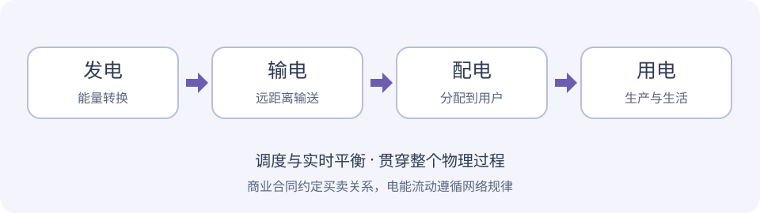

电能是一种商品，但不能脱离电网单独理解。合同可以提前签订，发电与用电却必须在交付时刻保持平衡；网络容量也会限制哪些交易可以实际执行。

## 从发电到用电



| 环节 | 主要作用 | 常见设备或场景 |
| --- | --- | --- |
| 发电 | 将其他形式的能量转换为电能 | 火电、水电、核电、风电、光伏 |
| 输电 | 远距离、大容量输送 | 高压线路、升压变压器、骨干网架 |
| 配电 | 将电分配到具体用户 | 配电线路、配电变压器、开关设备 |
| 用电 | 将电能转为生产生活需要的能量 | 电机、照明、空调、充电设施 |

电压等级不等于绝对的业务边界。110 kV、220 kV 等常见于高压网络，10 kV 常见于配电，低压终端常用 380/220 V；具体划分仍取决于当地网架与管理口径。

**变电站**负责电压变换和电能汇集、分配；**母线**是多条线路或设备的公共连接点。升高输电电压，可以在输送相同有功功率的条件下降低电流，从而减少线路电阻损耗。

## 交流与直流：不是谁全面替代谁

| 类型 | 基本特征 | 典型应用与约束 |
| --- | --- | --- |
| 交流 AC | 电压、电流周期变化 | 易用变压器变压，电网体系成熟；需处理频率、无功和同步问题 |
| 直流 DC | 电流方向不随交流周期交替 | 适合电池、光伏直流侧，也用于高压远距离输电和异步电网互联；换流、保护和开断要求不同 |

不能简单说“直流不适合远距离输电”。现代高压直流输电正是远距离、大容量输电的重要技术，选型要结合距离、容量、网络条件和工程成本。

## 三种典型网络结构

- **放射式**：从电源点逐级向外分支，结构简单，但单一供电路径的故障可能影响下游用户。
- **环网**：线路构成环形，配电网常采用开环运行；故障隔离后可按调度和操作规程转供。
- **网状结构**：存在多条联络路径，常见于输电网络；可靠性与调节能力较强，潮流计算和保护配合也更复杂。

交易中的“输电受限”，并不是地图上两地没有连线，而可能是某个断面、设备或安全约束不允许再增加输送。

## 功率与电量：先把单位分清

| 概念 | 含义 | 常见单位 |
| --- | --- | --- |
| 有功功率 P | 单位时间内转换或消耗有用能量的速率 | kW、MW |
| 电能量 E | 一段时间累计的能量 | kWh、MWh |
| 无功功率 Q | 与交流电磁场能量交换有关的量 | kvar、Mvar |
| 视在功率 S | 交流设备容量分析中的量 | kVA、MVA |

在功率恒定，或使用该时段平均功率时：

```text
电能量（kWh） = 平均功率（kW） × 时间（h）
2 kW × 3 h = 6 kWh
1 MW × 8 h = 8 MWh
1 MWh = 1,000 kWh
1 kWh = 3.6 MJ
```

实际功率会变化，因此电量是功率对时间的累计。额定 1 MW 的设备，并不意味着每小时一定产生或消耗 1 MWh。

在正弦稳态条件下，可用 `S² = P² + Q²`、`功率因数 = P / S` 理解三者关系。有功与频率、无功与电压存在重要联系，但真实电网中的耦合不能完全用一句话替代。功率因数也不等于设备能量转换效率。

## 为什么必须实时平衡

电能可以转化为化学能、势能等形式储存，但储能具有功率、容量、效率和成本约束，不能无限充当库存。

系统需要持续协调发电、负荷、储能和网络损耗。有功平衡发生偏差会影响频率，电压和无功也需要持续控制。这解释了为什么市场成交之外，还必须有调度、安全校核和辅助服务。

## 同一度电的时间与空间价值

**时间价值**来自不同时段的供需和调节条件。负荷高不一定对应最高现货价格，新能源高出力也可能改变传统峰谷分布。

**空间价值**来自网损、输送能力和阻塞。电源充裕地区的低成本电，不一定能不受限制地送到负荷中心；节点或分区价格机制可以体现部分空间差异。

所以电力交易分析需要同时看“多少电、什么时段、什么地点、如何结算”，不能只比较一个全年均价。

## 阅读小结

电网物理提供了电力市场的边界：网络约束不能忽略，功率与电量不能混用，价格也不能脱离时间和空间。下一章从经济学角度理解这些约束如何影响市场。

> 整理来源：个人笔记《电网基础知识》。交易组织方式归入后续“电力市场化”章节，避免将物理结构与商业机制混在一起。
